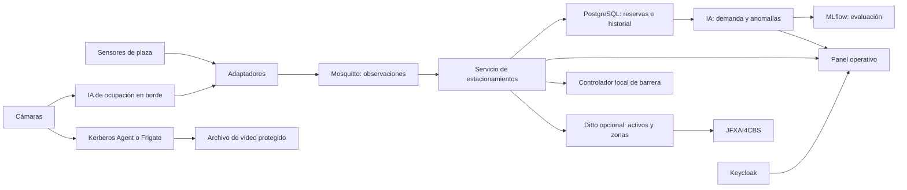

# JFOXPMS — Compendio de estacionamientos, arquitectura abierta e IA libre

Propuesta documental de integración. Revisión: **13 de octubre de 2026**.

## Propósito

Organizar sistemas y recursos para gestionar plazas, reservas, entradas y salidas, ocupación y supervisión de estacionamientos mediante una arquitectura abierta y sustituible. La IA aporta estimaciones y predicciones evaluables; las reservas y decisiones de acceso conservan reglas explícitas.

El repositorio contiene una propuesta y un catálogo, sin plataforma desplegada ni conectores implementados. Se conserva el [README original](docs/compendio-original.md), SHA `b6aa2118e9dc45a67fc844198f30f8848b3901d8`, para trazabilidad.

## 1. Lista categorizada del compendio original

| Categoría | Entrada y fuente identificada | Uso propuesto | Estado |
|---|---|---|---|
| Videovigilancia de borde | [Kerberos Agent](https://github.com/kerberos-io/agent) | Captura y gestión de vídeo de cámaras; adaptador de metadatos | Código MIT; no es un gestor de reservas. Evaluar Agent por separado de otros productos Kerberos |
| Gestión administrativa | Parking Management System Project In Java | Posible referencia para sesiones y operación | Pendiente de URL canónica y licencia; nombre insuficiente |
| Estacionamiento sin ticket | Zernike Facilities / P7 | Caso de uso de disponibilidad y acceso sin ticket | Referencia conceptual; implementación y licencia sin identificar |
| Visión e investigación | [Parkingslot](https://github.com/visualbuffer/parkingslot) | Experimentación con detección y clasificación de ocupación | Licencia explícita no encontrada; no aceptado como dependencia |
| Reservas y aparcamiento compartido | [TheParker Android](https://github.com/ketanchoyal/theParker) | Referencia móvil para oferta, búsqueda y reserva de plazas | Código MIT; Firebase/Maps son dependencias externas. Variantes iOS y Flutter requieren evaluación propia |
| Ocupación visual en navegador | [Parker](https://github.com/oxedom/parker) | Piloto de ocupación por plaza con TensorFlow.js y YOLOv7 | Código MIT; revisar pesos, dependencias y continuidad del servicio |
| Gestión web y extensión IoT | [Ezy-Parking](https://github.com/prathimacode-hub/Ezy-Parking) | Evaluar funciones de gestión y reservas para un servicio independiente | GPL v3; verificar funciones reales y alcance de licencia de la versión |
| Conteo de vehículos con IA | Smart Park with YOLO-V3 | Referencia para comparar conteo y detección | Pendiente de repositorio y licencias; Google Colab no forma parte de la base autoalojada |
| Seguridad robótica | Robotic Security System | Escenario futuro de supervisión de zonas | Visión conceptual del original, sin componente ejecutable identificado |

Todas las entradas originales permanecen representadas. Identificar un proyecto externo por nombre y descripción no demuestra que exista un fork suyo en los perfiles revisados. La evaluación de estacionamientos también está enlazada desde [JFXAI4CBS](https://github.com/robotics-intelligent-systems/jfxai4cbs/blob/main/docs/integrations/parking-management.md).

## 2. Componentes complementarios de software libre

| Capa | Componente propuesto | Licencia del código revisada | Función en la propuesta |
|---|---|---|---|
| Eventos | [Eclipse Mosquitto](https://github.com/eclipse-mosquitto/mosquitto) | EPL-2.0 OR BSD-3-Clause | Bus MQTT para observaciones y estado |
| Reservas e historial | [PostgreSQL](https://github.com/postgres/postgres) | PostgreSQL, según COPYRIGHT | Persistencia transaccional, auditoría e historial |
| Identidad | [Keycloak](https://github.com/keycloak/keycloak) | Apache-2.0 | Identidad central; adaptar clientes compatibles con OIDC |
| Gemelos opcionales | [Eclipse Ditto](https://github.com/eclipse-ditto/ditto) | EPL-2.0 | Representación de plazas, zonas, sensores y barreras; conexión con JFXAI4CBS |
| Procesamiento visual | [OpenCV](https://github.com/opencv/opencv) | Apache-2.0 en la rama revisada | Calibración, máscaras y procesamiento de imágenes |
| Modelos estadísticos | [scikit-learn](https://github.com/scikit-learn/scikit-learn) | BSD-3-Clause | Predicción de ocupación, comparación de modelos y anomalías |
| Trazabilidad de IA | [MLflow](https://github.com/mlflow/mlflow) | Apache-2.0 | Registro de experimentos, métricas y artefactos |
| Intercambio de modelos | [ONNX](https://github.com/onnx/onnx) / [ONNX Runtime](https://github.com/microsoft/onnxruntime) | Apache-2.0 / MIT | Intercambio e inferencia cuando el modelo sea compatible |
| NVR alternativo | [Frigate](https://github.com/blakeblackshear/frigate) | MIT | Alternativa a Kerberos Agent para detección local; seleccionar un NVR principal |

Las licencias anteriores corresponden al código revisado, no a todas las imágenes de contenedor, bibliotecas, pesos, datos, aceleradores o servicios opcionales. Antes del despliegue se fijarán versiones y se revisará su composición. Para Mosquitto se comprobó [LICENSE.txt](https://github.com/eclipse-mosquitto/mosquitto/blob/master/LICENSE.txt); PostgreSQL se comprobó en [COPYRIGHT](https://github.com/postgres/postgres/blob/master/COPYRIGHT).

## 3. Arquitectura de integración propuesta

Las flechas son conexiones propuestas que requieren implementación y pruebas. La IA de ocupación puede usar un flujo autorizado de cámara; no se presupone que Kerberos o Frigate expongan una interfaz común. El bus transporta metadatos, no vídeo completo.

Base mínima propuesta: **un capturador de vídeo, un método validado de ocupación, Mosquitto, servicio de estacionamientos propio, PostgreSQL, identidad y panel**. Ditto y los modelos predictivos se incorporan tras validar la operación básica. Mantener infraestructura y lógica de dominio separadas.

## 4. Inteligencia artificial de software libre

- **Ocupación por plaza:** empezar con sensores o una referencia visual sencilla; comparar Parker y un servicio de borde. Evaluar día/noche, lluvia, sombras, oclusión y desplazamiento de cámara.
- **Predicción de demanda:** comenzar con promedio histórico y modelos de scikit-learn. Entrenar con datos propios autorizados y separar entrenamiento y prueba por tiempo e instalación.
- **Anomalías operativas:** detectar señal congelada, sensores desconectados, permanencias atípicas y discrepancias entre sesiones y ocupación. Medir falsas alertas.
- **Asignación de plazas:** comenzar con restricciones y reglas transparentes; usar predicciones para recomendar, conservando una reserva transaccional.
- **Trazabilidad:** registrar datos, código, parámetros, versión y métricas en MLflow. Promover modelos únicamente después de superar evaluación local.

La base libre no depende de un LLM, reconocimiento facial ni una nube de entrenamiento. La licencia de Parker o de un motor de inferencia no concede permisos sobre un modelo preentrenado. Para una pila libre, aceptar solamente pesos y datos con derechos suficientes de uso, modificación y distribución; mantener los demás fuera de la base hasta aclararlos.

## 5. Contratos, integración y piloto

[Propuesta detallada](docs/arquitectura-abierta-ia.md): responsabilidades, eventos, APIs propuestas, reemplazo de servicios externos, decisiones de arquitectura, pruebas y etapas.

[Catálogo categorizado](catalog/components.json): entradas originales, complementos, evidencias de licencia, estados y condiciones de promoción.

1. Identificar las referencias pendientes y fijar versiones de candidatos seleccionados.
2. Probar una cámara, varias plazas y un sensor de contraste con estados libre/ocupado/desconocido.
3. Implementar observación → adaptador → MQTT → historial y panel; probar duplicados y desconexión.
4. Incorporar reservas con exclusión de intervalos solapados, expiración y autenticación.
5. Evaluar predicción de demanda y alertas frente a referencias simples.
6. Añadir Ditto y el intercambio con JFXAI4CBS; probar control de barrera en una etapa independiente.

Los umbrales, carga y tiempos de retención se fijarán antes de ejecutar el piloto. No se promete precisión, rendimiento ni integración nativa sin pruebas.
